<div align="center">


 



 

 


 

</div>

### Silicon Floor

Le terminal des valeurs de l'IA et des semi-conducteurs. Qui détient quoi, qui achète, qui vend : chaque chiffre
reconstruit depuis les dépôts de la SEC, daté et cité. Serveur **MCP** public, 18 outils, sans clé ni inscription.

```
claude mcp add --transport http siliconfloor https://siliconfloor.com/mcp
```

[siliconfloor.com](https://siliconfloor.com) · [Documentation](https://siliconfloor.com/docs/mcp) · [Dépôt](https://github.com/Baptoshi/silicon-floor) · [`npx siliconfloor-mcp`](https://www.npmjs.com/package/siliconfloor-mcp)

---

<sub>
Douze widgets redessinés toutes les deux heures par <a href="scripts/card.mjs">scripts/card.mjs</a>, depuis l'API
GitHub et le flux d'événements publics. Chacun dit la mesure qu'il trace, son unité et sa fenêtre : rien n'est noté,
pondéré ni extrapolé. Les dépôts y sont <strong>publics uniquement</strong> et lus en <strong>agrégat</strong> —
langages, millésimes, tailles, étoiles : ni nom, ni contenu, ni description. Les heures viennent des derniers
événements publics, sur la fenêtre que l'API rend, affichée sur les cadrans.
</sub>
