<div align="center">



</div>

### Silicon Floor

Le terminal des valeurs de l'IA et des semi-conducteurs. Qui détient quoi, qui achète, qui vend : chaque chiffre
reconstruit depuis les dépôts de la SEC, daté et cité. Serveur **MCP** public, 18 outils, sans clé ni inscription.

```
claude mcp add --transport http siliconfloor https://siliconfloor.com/mcp
```

[siliconfloor.com](https://siliconfloor.com) · [Documentation](https://siliconfloor.com/docs/mcp) · [Dépôt](https://github.com/Baptoshi/silicon-floor) · [`npx siliconfloor-mcp`](https://www.npmjs.com/package/siliconfloor-mcp)

---

<sub>
La fiche est redessinée une fois par jour par <a href="scripts/card.mjs">scripts/card.mjs</a> depuis l'API GitHub.
Chaque panneau dit la mesure qu'il trace : rien n'est noté, pondéré ni arrondi. Les dépôts n'y sont lus qu'en
<strong>agrégat</strong> — langages, millésimes, tailles, étoiles : ni nom, ni contenu, ni description. Les
contributions aux dépôts privés n'entrent dans les séries que si le profil les publie
(<em>Settings → Profile → Include private contributions on my profile</em>).
</sub>
